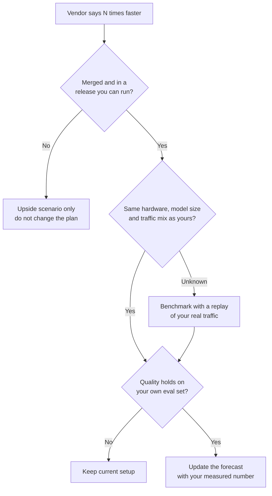

# Gemma 4's 2.85x Speedup: What I'd Ask Before Planning on It

If you build on Gemma 4, this line will reach you secondhand: "Google made it almost 3x faster." Somebody will say it in a planning meeting, and someone else will start rewriting the cost forecast.

My first reaction as a PM isn't excitement. It's a boring question: can I put this number in a plan? So I went and read the pull requests behind it.

The claim comes from Google's Gemini 4 Argon launch post. It says Argon sped up Gemma 4 E2B on vLLM from about 37,900 to over 108,000 tokens per second on an A100, with no quality drop, in a few days. Google links the pull requests.

I'm not a kernel engineer, so I read them the way a PM would: what's claimed, what's measured, what's merged. I read two in full and skimmed a third. I haven't run any of this myself.

## The claim, graded for planning

I'm not doubting the engineering. I'm asking a narrower question: is this safe to plan on?

| Claim | What I found | Safe to plan on? |
|---|---|---|
| 2.85x end to end | No single pull request I opened reproduces it. The parts report 1.04x to 1.12x on prefill and 1.37x to 3.23x on the drafter loop. | No |
| Shipped in vLLM | The two PRs I read in full are still open, and one has merge conflicts. | Not yet |
| Same quality | The attention PR shows 92% to 99.6% agreement with old outputs, and accuracy moved between minus 0.5 and plus 1.5 points. | Likely, but check on your own evals |
| Works on your hardware | Numbers come from an A100. One reviewer saw slowdowns on an RTX 5090. | Test first |

The gains from separate changes may well add up to 2.85x. I just couldn't find the combined run, and the post doesn't say what batch size or traffic mix produced it.

## A simple rule for "N times faster"

This is the flow I'd use for any speed claim from a vendor.

The first question does most of the work. A change that isn't in a release can't be in your cost model.

## What it would mean for cost and latency

If throughput really doubled on the same GPUs, cost per token would roughly halve. That's just arithmetic. The catch is that it only helps if your GPUs are busy. If they sit half idle today, a faster server idles faster and your bill doesn't move.

Users also don't feel one speed. The attention change mostly helps prefill, which is the wait before the first word shows up. The drafter work helps how quickly the rest of the answer streams. A chat reply is mostly about the first token. A long report is mostly about streaming.

So I'd keep two scenarios in the forecast. The base case uses today's measured numbers. The upside case uses the speedup, and only switches on after you've measured it yourself.

## Five questions I'd send to engineering

1. Which vLLM release contains these changes, and are we on it?
2. What GPU did Google measure on, and is it the one we run?
3. What batch size and request mix produced the headline number?
4. How does quality look on our own eval set, not a public benchmark?
5. If it's slower on our hardware, how fast can we roll back?

If nobody can answer the first one, that's your answer.

## The part that's really about product

Google says Argon in its coding tool helped teams raise agentic code submissions by more than 35% while cutting rollbacks by nearly a third. Those are Google's own internal figures, so I'd treat them as directional. The pull requests show the same pattern in miniature. Both I read tick the box saying AI assistance was used, each comes with its own benchmark scripts, and a stranger on different hardware still found a regression within days.

If your team is adopting AI coding agents, the takeaway for me is that producing changes gets cheap while checking them doesn't. Budget review time and measurement for it. That's where the quality of the result gets decided.

## Where I land

I'd treat 2.85x as a promising claim, not a deployed result. Put it in the upside column, ask the five questions, and look again once the changes merge and ship in a release you can test.

## References

1. Google, [Gemini 4 Argon: Built to solve your hardest problems](https://blog.google/innovation-and-ai/models-and-research/gemini-models/introducing-gemini-4-argon/), Oct 13, 2026.
2. vLLM, [PR 60317: Optimize Triton unified attention for head_dim=512 and sliding-window decode](https://github.com/vllm-project/vllm/pull/60317).
3. vLLM, [PR 60689: Fuse MTP speculative decoding layers and sparse gather-GEMV LM head](https://github.com/vllm-project/vllm/pull/60689).
4. vLLM, [PR 60504: Add tuned Triton FusedMoE configs for Gemma 4 26B-A4B](https://github.com/vllm-project/vllm/pull/60504).
5. vLLM, [PR 41745: Add Gemma4 MTP speculative decoding support](https://github.com/vllm-project/vllm/pull/41745).
6. Google, [Accelerating Gemma 4: faster inference with multi-token prediction drafters](https://blog.google/innovation-and-ai/technology/developers-tools/multi-token-prediction-gemma-4/).
